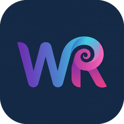
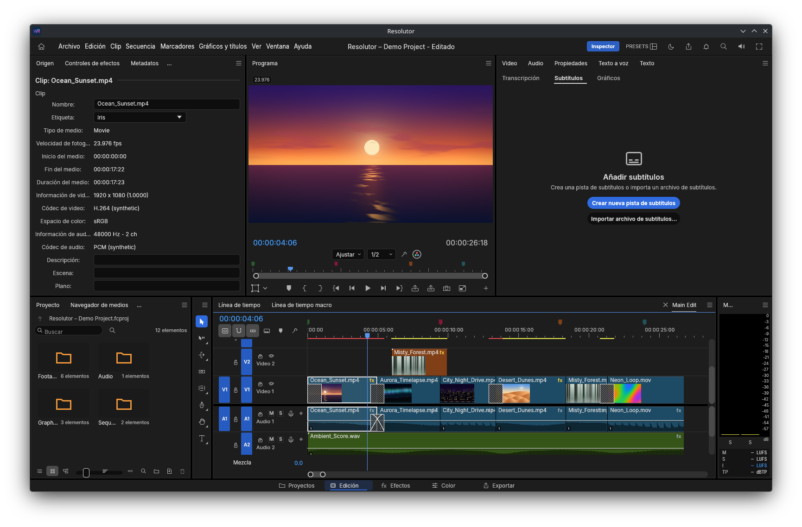
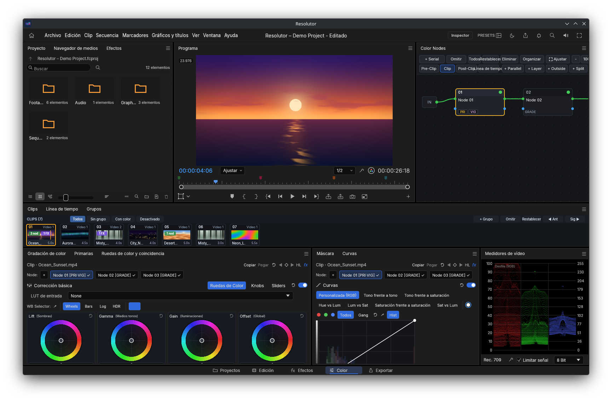
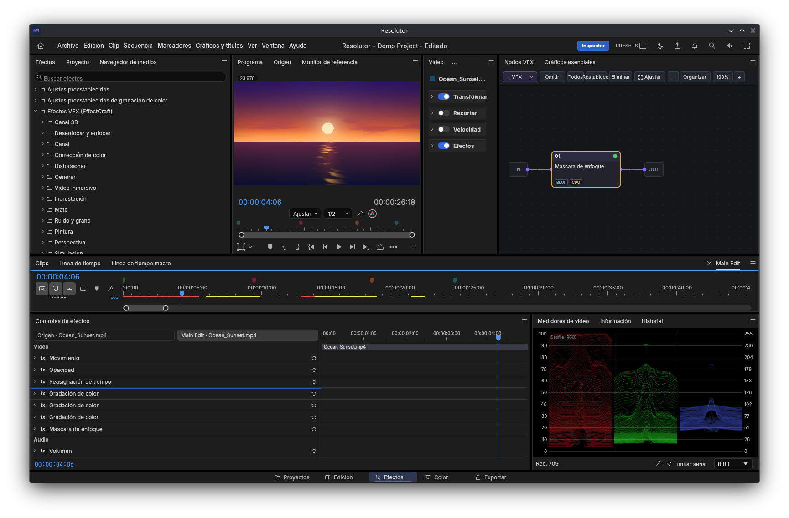
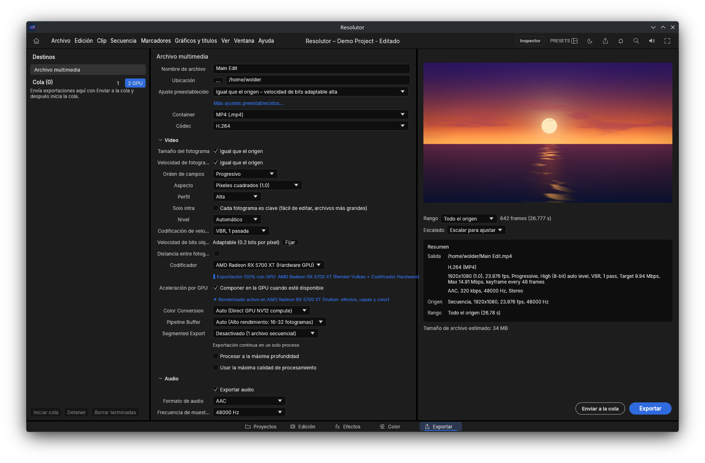

<p align="center">
  
</p>

<h1 align="center">Woldercraft Resolutor</h1>

<p align="center">
  <b>Video editing, color grading, and VFX nodes; a pure-Rust non-linear video editor based on <a href="https://github.com/storytold/filmcraft">FilmCraft</a> (ArtCraft) and powered by EffectCraft VFX.</b>
</p>

<p align="center">
  An open-source, modern non-linear video editing workflow: native on macOS, Windows and Linux, and in the browser via WebAssembly.<br>
  Built on the shoulders of the <a href="https://getartcraft.com/">ArtCraft / FilmCraft</a> project and contributors.
</p>

<p align="center">
  <a href="#license-and-credits"></a>
  
  
  <a href="#status"></a>
</p>

<br>

<p align="center">
  
</p>

<p align="center"><sub><i>Woldercraft Resolutor</i> running the built-in Demo Project: multi-track timeline, Program monitor, clip metadata, and live loudness meters. Every frame is decoded, composited, and graded by Resolutor's own Rust engine.</sub></p>

<p align="center">
  <a href="#edit">Edit</a> ·
  <a href="#color">Color</a> ·
  <a href="#effects-and-motion">Effects &amp; VFX</a> ·
  <a href="#audio">Audio</a> ·
  <a href="#titles-and-captions">Titles</a> ·
  <a href="#formats-and-codecs">Formats</a> ·
  <a href="#export">Export</a> ·
  <a href="#interchange">Interchange</a> ·
  <a href="#built-for-agents">Agents</a> ·
  <a href="#get-started">Get started</a> ·
  <a href="#documentation">Docs</a> ·
  <a href="#status">Status</a>
</p>

<br>

**Woldercraft Resolutor** is a pure-Rust non-linear video editor, color grader, and node-based VFX compositor built on [FilmCraft](https://github.com/storytold/filmcraft) (ArtCraft) and powered by **EffectCraft VFX**. Familiar panels, workspaces, tools, and shortcuts let you get straight to cutting, while underneath everything is written in Rust from the public specifications: H.264, HEVC, ProRes, VP8/VP9, AV1, and AAC/Opus codecs, a linear-light Vulkan/wgpu GPU compositor, non-linear Color &amp; VFX node graphs, exact integer time math so edits never drift, and a full command/MCP layer for AI agents.

<br>

## Edit

**A timeline you already know.** Source and Program monitors, bins with thumbnails, a multi-track timeline with patch and target buttons, sync locks, and linked selection. Dedicated **Projects**, **Edit**, **Effects**, **Color**, and **Export** workspaces keep each stage focused, and every panel docks wherever you want it.

- **Three-point editing.** Mark In and Out in the Source monitor, then insert (`,`) or overwrite (`.`) onto the patched tracks. Lift (`;`) and extract (`'`) take ranges back out.
- **Every trim.** Ripple, roll, slip, slide, rate stretch and razor tools. Trim mode selects edit points as ripple, roll or trim, nudges them a frame at a time (`⌥←` `⌥→`, ×5 with `⇧`), toggles the trim type with `⌃T` and extends them to the playhead with `E`. `Q` and `W` ripple-trim to the playhead. The **Trim Monitor** shows both sides of the edit, and **dynamic trimming** trims live while it plays: `L` forward, `J` back, `K` to stop and commit as one undo step.
- **Exact time.** Every edit is computed on integer ticks: 254,016,000,000 per second, which divides evenly by every common frame rate and sample rate. 23.976, 29.97 drop-frame and 59.94 are exact, not approximate.
- **The details pros rely on.** Markers with colours, names and durations; export sequence review notes with **Markers ▸ Export Markers as CSV…**; add edit (`⌘K`) on one or all tracks; nesting; copy, paste and paste insert; ripple delete and close gap; snapping; unlimited undo with a History panel.
- **Your keys.** A Keyboard Shortcuts editor (`⌥⌘K`) with a drawn keyboard, panel-specific shortcuts, conflict warnings and presets for Resolutor / FilmCraft and standard NLE key layouts.
- **Never lose work.** Saves are atomic, auto-save keeps a rolling set of versions, and a crash-recovery journal written about a second after each edit brings back unsaved changes after a crash or power cut.

<br>

## Color

<p align="center">
  
</p>

<p align="center"><sub>The Color workspace: node-based Color Nodes graph, clip strip, Lift/Gamma/Gain/Offset color wheels, RGB curves, and live RGB Parade scopes.</sub></p>

**A node-based color grading workspace**, in the order a colourist works:

- **Color Nodes DAG:** chain Serial, Parallel, Layer, Outside, and Split nodes per clip, with Pre-Clip, Clip, Post-Clip, and Timeline scopes.
- **Basic &amp; Primary Correction:** temperature and tint, exposure, contrast, highlights, shadows, whites, blacks, saturation, and Lift/Gamma/Gain/Offset color wheels, plus Log and HDR wheels.
- **Creative:** built-in looks with an intensity control, plus faded film, sharpen and vibrance. The looks are colour transforms written in code, not LUT files.
- **Curves:** an RGB curve editor with monotone-cubic interpolation (no overshoot), and hue vs saturation, hue vs hue, hue vs luma, luma vs saturation and saturation vs saturation.
- **HSL Secondary &amp; Vignette:** key a colour by hue, saturation and luma, view the key as a matte, and shape vignettes with amount, midpoint, roundness and feather.
- **Live Video Scopes:** RGB Parade, Waveform, Vectorscope, and Histogram computed from the graded frame in 32-bit float linear light.

<br>

## Effects and motion

<p align="center">
  
</p>

<p align="center"><sub>The Effects workspace: EffectCraft VFX browser, VFX Nodes graph, Effect Controls keyframe lanes, and live RGB Parade scopes.</sub></p>

- **EffectCraft VFX &amp; Video Effects (over 90 effects across 16 categories), plus around 30 transitions.** Blurs (Bokeh, Focus, Compound), keys (Ultra Key, Track Matte), distortions (Corner Pin, Turbulent Displace, Warp Stabilizer), Lights &amp; Glows, Immersive Video (VR) effects on equirectangular footage, Posterize Time, Echo and more. Cross dissolve, dip to black or white, film dissolve, wipes, irises, pushes, slides, zooms, page peel, cube spin and more.
- **Non-linear VFX Nodes:** build per-clip VFX DAGs with GPU-accelerated nodes, inspect parameters in `VfxInspector`, and animate them in `VfxKeyframes`.
- **Motion and opacity on every clip:** position, scale, rotation, anchor point and anti-flicker, plus 26 blend modes.
- **Advanced keyframing:** linear, Bezier, auto and continuous Bezier, hold, ease in and ease out. Effect Controls shows a keyframe lane for every parameter under a time ruler with the playhead's handle, and each animated parameter opens into **value and velocity graphs** with draggable influence handles.
- **A GPU compositor** built on wgpu (Metal, Vulkan, DirectX 12, WebGPU). It samples YUV straight from the decoder with footprint supersampling and blends in linear light. A CPU path renders the same frames, and the two are tested against each other.

<br>

## Audio

- **Loudness meters to broadcast standards.** Momentary, short-term and integrated loudness and true peak to ITU-R BS.1770 and EBU R128, alongside the peak meters. Our integrated reading matches ffmpeg's `ebur128` filter to the tenth of a LU.
- **Clip effects on our own DSP library:** parametric EQ, high-pass, low-pass and band-pass filters, dynamics, a true-peak limiter, delay, reverb, DeNoise, DeHummer, invert and pitch shift. Parameters can be keyframed. Effects stay continuous across scrubbing, playback and export, with latency compensated.
- **Audio Track Mixer and Audio Clip Mixer:** faders, pan, mute, solo, five insert slots per track (pre- or post-fader), sends, submixes and a Mix track, all sample-accurate and latency-compensated. 24 tracks with three effects each mix about six times faster than real time on one core.
- **Automation like a console:** Read, Latch, Touch and Write modes recorded live from the mixer during playback, shown and edited as track keyframes on the timeline. Plus the Audio Gain dialog (set, adjust, normalize) and constant-power crossfades.
- **Audio-clock playback.** The sound card is the master clock, so picture follows sound and never the other way round.

<br>

## Titles and captions

- **A real text engine:** OpenType shaping with kerning and ligatures, bidirectional text, line breaking, tracking and leading, drawn in linear light and sharp at any scale or rotation.
- **Type, Shape and Pen tools** on the Program monitor: click to type, edit with a caret and selection, drag out rectangles, ellipses and paths. Graphic clips hold text and shape layers with fill, strokes, background and shadow, all keyframable, and edited in the Properties panel.
- **Captions:** caption tracks in Subtitle, CEA-608, CEA-708 and Teletext formats; import and export SRT, WebVTT and SCC with frame-exact timing; edit captions in the Text panel and burn them into exports.
<br>

## Formats and codecs

No FFmpeg inside. The video codecs, AAC, Opus and the containers are our own Rust code, implemented from the public ITU-T, ISO and IETF specifications and tested frame by frame against ffmpeg as an external oracle.

| | Decode | Encode | Notes |
|---|:---:|:---:|---|
| **H.264 / AVC** | ✓ | ✓ | Decoder bit-exact on 37+ streams, 500–600 fps at 1080p. Encoder: High, Main and Baseline profiles, CABAC, B-frames, CRF/CBR/VBR/2-pass |
| **HEVC / H.265** | ✓ | | Main and Main 10, bit-exact on 41 streams (tiles, WPP, PCM, long-term references), about 225 fps at 1080p |
| **Apple ProRes** | ✓ | ✓ | Decodes 422 Proxy to 4444 XQ; export writes 422 HQ |
| **AAC-LC** | ✓ | ✓ | |
| **VP8** | ✓ | | Every coding tool, bitstream versions 0–3, hidden altref frames, alpha layer of transparent WebM; bit-exact with libvpx on its published VP8 test vectors; in WebM/Matroska and MP4 |
| **VP9** | ✓ | | Profiles 0–3, 8/10/12-bit, 4:2:0 to 4:4:4, tiles and superframes; bit-exact on 50+ streams; in WebM/Matroska and MP4 |
| **Opus** | ✓ | | SILK, CELT, hybrid and multistream surround; range-exact on every RFC 8251 conformance vector; in WebM/Matroska and MP4 |
| **AV1** | ✓ | | Main profile, 8/10-bit 4:2:0 and monochrome, every coding tool incl. film grain, superres and spatial layers; bit-exact with libdav1d on the libaom vectors tested; in MP4 and WebM/Matroska |
| **DNxHD / DNxHR** | ✓ | ✓ | All SMPTE ST 2019-1 CIDs (LB to 444, 8/10/12-bit); export writes DNxHR in MOV |
| **MJPEG, PCM** | ✓ | ✓ | |
| **MP3, FLAC, ALAC, Vorbis** | ✓ | | Via the [symphonia](https://github.com/pdeljanov/Symphonia) crate (MPL-2.0) for now, to be replaced by our own |
| **MP4 / MOV** | ✓ | ✓ | Fragmented MP4, edit lists, timecode tracks |
| **Matroska / WebM** | ✓ | | Lacing, Cues, header stripping, HDR colour metadata |
| **AVI** | ✓ | | AVI 1.0 and OpenDML (files past 1 GB); Motion JPEG, H.264, HEVC and uncompressed RGB / YUV with PCM, MP3, MP2 or AC-3. DivX / Xvid and DV not yet |
| **Stills** | ✓ | ✓ | Import PNG, JPEG, GIF, WebP, TIFF and BMP (animated GIF, APNG and WebP as clips, with transparency); export PNG sequences and animated GIF |

Also imported: MPEG-2 / MPEG-1 video, AC-3, MP2, MXF (OP1a / OP-Atom), MPEG transport and program streams (AVCHD, broadcast, DVD), Ogg and image sequences. Not yet: AV1 export, camera RAW, E-AC-3. Hardware decoding works on macOS (VideoToolbox), Windows (Media Foundation) and, for H.264 and HEVC, Linux (VA-API); H.264 export can use NVIDIA's encoder on Windows and Linux (opt-in), and H.265 (HEVC Main, 8-bit) export works through it (NVENC on Windows, VideoToolbox on macOS) ([#30](https://github.com/storytold/filmcraft/issues/30)).

<br>

## Export

<p align="center">
  
</p>

<p align="center"><sub>Export workspace, configured for GPU-accelerated Vulkan rendering and hardware H.264 MP4 encoding.</sub></p>

- **H.264 MP4 with AAC, using our own encoders.** A 6-second 960×540 render takes 1.3 seconds and decodes in ffmpeg without a single warning, with strict error detection on.
- **Also:** Apple ProRes 422 HQ and Motion JPEG in QuickTime, MXF OP1a and standard OP-Atom (DNxHR, ProRes or H.264 with PCM and start timecode), PNG sequences, animated GIF and WAV.
- **Background jobs** with progress and cancel, so you keep editing while it renders.
- **Render previews:** the render bar marks segments green, yellow or red; rendered previews are cached by content, so an edit only invalidates what it touches and undo brings the green back.

<br>

## Interchange

Move timelines between Woldercraft Resolutor and other editors:

- **FCP 7 XML (xmeml):** industry-standard timeline interchange format. It carries nested sequences, transitions, generators, Motion, Opacity, Time Remap and audio levels, with keyframes.
- **FCPXML 1.9–1.11:** the spine, connected clips as lanes, transitions, retiming and compound clips.
- **OpenTimelineIO:** the open interchange format of the film industry, round-tripping sequence metadata through `metadata.filmcraft`.
- **CMX 3600 EDL:** the oldest format still in use, with drop-frame timecode, dissolves, wipes, speed changes (`M2`) and one EDL per track.
- **AAF (Edit Protocol):** standard timeline and audio interchange format. Video and audio tracks, dissolves and dips, clip volume with keyframes, markers and source timecode; audio embedded or as separate WAV / AIFF files, trimmed with handles, with clip effects rendered in and broken out to mono, plus an optional video mixdown. Import reads AAF back, extracting embedded audio.
- **OMF 2.0:** the audio-post handoff: the audio tracks with crossfades and gain, sample-accurate, with the audio encapsulated or alongside.

Import merges the document's bins, media and sequences into your project as one undoable step, and links each media file it finds on disk.

<br>

## Built for agents

Every menu item, button, slider and drag in Woldercraft Resolutor is a **command** with an id, typed parameters and an enabled state. There are more than 650 engine commands (`filmcraft-cli commands` lists them), with more commands continuously added. The UI, the CLI, a JSON control channel and an **MCP server** all dispatch the same commands, so an AI agent can cut, trim, grade, mix and export exactly the way a person does. The UI can also be driven at the level of mouse and keyboard: every widget has an automation id, and agents can click, drag, type and take screenshots.

```jsonc
// over the control channel (JSON lines on TCP) or as MCP tool calls
{"method": "engine.execute", "params": {"command": "timeline.place",
  "params": {"item": 1, "track": "V1", "seconds": 0, "sourceIn": 284298240000000, "duration": 1270080000000}}}
{"method": "engine.execute", "params": {"command": "effects.setParam",
  "params": {"clip": 87, "effect": "lumetri", "param": "curve_luma", "value": [[0,0],[0.25,0.21],[0.75,0.82],[1,1]]}}}
{"method": "ui.screenshot", "params": {"path": "frame.png"}}
```

The grades, effects, and node setups in these screenshots were driven directly over the control channel on the built-in Demo Project.

<br>

## Everywhere

- **Native** on macOS, Windows and Linux, with a native macOS menu bar.
- **The web:** the same engine and UI run in the browser via WebAssembly (`apps/filmcraft-web`, see [docs/web.md](docs/web.md)).
- **Swappable UI.** The interface is one crate (`ui-egui`) over the engine, so a different front end can replace it without touching editing logic.

<br>

## Get started

New to editing in Woldercraft Resolutor? Follow [Getting started: video fades and audio volume keyframes](docs/getting-started-fades.md).

```sh
cargo run --release -p filmcraft                           # the desktop app, with a demo project
cargo run --release -p filmcraft -- --control 9876         # plus the JSON-lines control server
cargo run --release -p filmcraft-cli -- commands           # list every engine command
cargo run --release -p filmcraft-cli -- mcp                # MCP server (headless)
```

Optional extended fonts come from [craft-fonts](https://github.com/storytold/craft-fonts) (without it, Resolutor uses its own bundled and system fonts):

```sh
git clone https://github.com/storytold/craft-fonts ../craft-fonts
CRAFT_FONTS_DIR="$PWD/../craft-fonts" cargo run --release -p filmcraft
```

The control protocol is documented in [docs/control-protocol.md](docs/control-protocol.md).

## Documentation

| | |
|---|---|
| [CONTRIBUTING.md](CONTRIBUTING.md) · [docs/contributing.md](docs/contributing.md) | Setup, quality gates, commit conventions, how to add commands, effects, codecs, panels and assets |
| [AGENTS.md](AGENTS.md) | The rules every contributor must follow: assets, clean room, licences |
| [docs/architecture.md](docs/architecture.md) | Layers, data model, time base, command system, render and export pipeline |
| [docs/testing.md](docs/testing.md) | Unit, property and ffmpeg-oracle tests, accuracy criteria, benchmarks |
| [docs/agents.md](docs/agents.md) | Driving Resolutor over MCP and the control channel |
| [docs/control-protocol.md](docs/control-protocol.md) | Control-channel and MCP reference |
| [docs/project-files.md](docs/project-files.md) | `.fcproj` format, schema migrations, auto-save and crash recovery |
| [docs/graphics.md](docs/graphics.md) · [docs/captions.md](docs/captions.md) | Text engine, graphic clips and tools; caption tracks and formats |
| [ROADMAP.md](ROADMAP.md) | Stage, parity numbers, languages, what's next and the progress log |

## Status

Woldercraft Resolutor is in active development. Multi-track editing, trimming, multicam, node-based color grading, VFX node graphs, keyframes, effects, titles, captions, audio mixing, built-in codecs, and GPU-accelerated export work today.

## Architecture

A layered Cargo workspace:

| Layer | Crates |
|---|---|
| Codecs and containers | `h264`, `h264enc`, `hevc`, `vp9`, `prores`, `aac`, `opus`, `isobmff`, `matroska`, `avi`, `bitstream` |
| Foundations | `time`, `geom`, `color`, `frame`, `media`, `text`, `project`, `audio-dsp` |
| Editing and interchange | `edit`, `codecs`, `captions`, `format` (project files), `interchange` |
| Rendering and output | `render`, `gpu`, `export` |
| Engine | `engine`: command registry, session, undo, jobs |
| Front ends | `ui-egui`, `automation` (MCP), `apps/filmcraft`, `apps/filmcraft-cli` |
| Test support | `testkit` (ffmpeg oracles, fixtures), `golden` (golden-image tests) |

Nothing below the front ends depends on a UI toolkit or OS API. `cargo xtask ci` checks formatting, lints, tests, the layering rules, asset attribution and the wasm build.

<br>

## License and credits

Woldercraft Resolutor is dual-licensed under [MIT](LICENSE-MIT) or [Apache-2.0](LICENSE-APACHE), at your option.

**Acknowledgments:** Special thanks to the [FilmCraft](https://github.com/storytold/filmcraft) and [EffectCraft](https://github.com/storytold/effectcraft) projects, the ArtCraft Team, and all upstream contributors whose open-source foundation makes this project possible. Required notices are in [NOTICE](NOTICE).

Bundled fonts, icons, images and other assets keep their own open licenses; each one is listed with its author, source and license in [ATTRIBUTION.md](ATTRIBUTION.md).

**Media in the screenshots:** All frames and audio waveforms shown in the README screenshots come from the built-in procedural Demo Project (`Ocean_Sunset.mp4`, `Aurora_Timelapse.mp4`, `City_Night_Drive.mp4`, `Desert_Dunes.mp4`, `Misty_Forest.mp4`, `Neon_Loop.mov`, and `Ambient_Score.wav`), generated by the engine's own Rust code under `MIT OR Apache-2.0`. Sources and details for every asset are in [ATTRIBUTION.md](ATTRIBUTION.md).

Woldercraft Resolutor contains no proprietary code, icons, images, presets or LUTs, and no GPL or LGPL code; every icon is drawn in code and every asset is openly licensed and attributed ([AGENTS.md](AGENTS.md)). `ffmpeg` is used only as an external test oracle.
